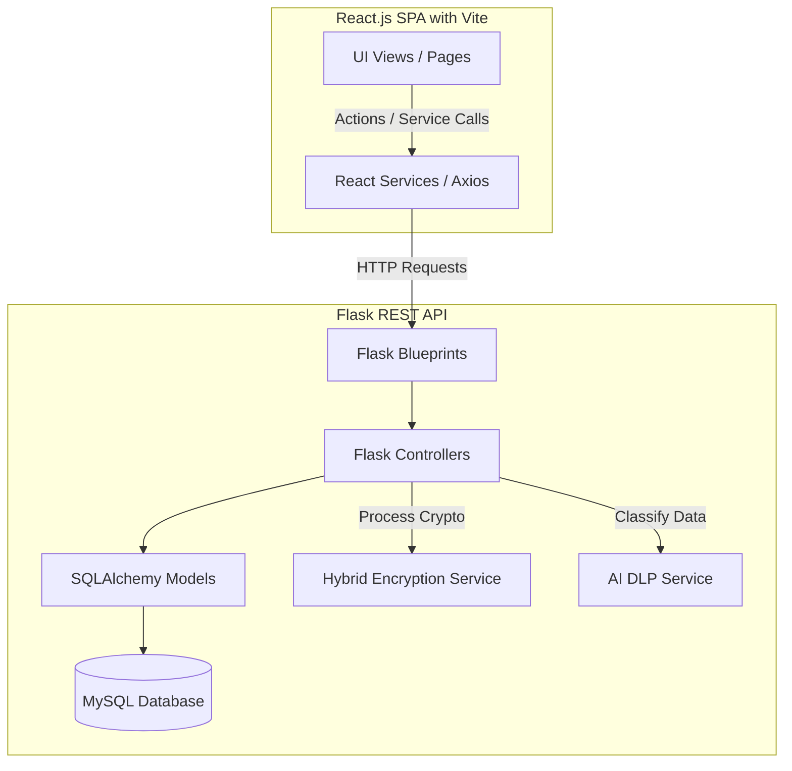

# CipherGuard: Intelligent Hybrid Encryption & Data Leak Prevention Platform

CipherGuard is a cutting-edge, professional full-stack cybersecurity web application designed to secure sensitive data using a hybrid cryptosystem and identify potential data breaches through an intelligent Data Leak Prevention (DLP) engine.

---

## 🛡️ Platform Features

1. **Intelligent Hybrid Cryptosystem**:
   - High-speed symmetric encryption (AES-GCM / ChaCha20-Poly1305) for large files and data fields.
   - Secure asymmetric key exchange (RSA-OAEP / ECC) for key distribution.
   - Robust key derivation functions (PBKDF2, Argon2) and hashing (bcrypt, SHA-256).

2. **AI-Powered Data Leak Prevention (DLP)**:
   - Real-time text scanning and document classifying using scikit-learn models.
   - PII (Personally Identifiable Information), credentials, and intellectual property detection.
   - Automated risk scoring and audit logs of suspected data transfer attempts.

3. **Secure Document & Vault Management**:
   - Secure upload, encryption, storage, and decryption workflows.
   - Encrypted QR code generation for secure mobile file access sharing.
   - Fine-grained access control with MySQL back-end validation.

4. **Interactive Security Analytics**:
   - Visual dashboard illustrating encryption usage stats, DLP violations, threat metrics, and audit timelines.

---

## 🏗️ System Architecture

CipherGuard follows a clean **MVC (Model-View-Controller)** pattern:



---

## 📂 Directory Layout

```
Cipher Guard/
├── backend/                             # Python Flask REST API
│   ├── app/
│   │   ├── AI/                          # ML models and DLP pipelines
│   │   ├── config/                      # Flask configuration & environment loader
│   │   ├── controllers/                 # MVC Controllers handling business logic
│   │   ├── database/                    # Connection setup and SQLAlchemy engines
│   │   ├── encryption/                  # Hybrid cryptographic core
│   │   ├── models/                      # SQLAlchemy database schemas
│   │   ├── routes/                      # API endpoint routing declarations
│   │   ├── services/                    # Background processes and third-party wrappers
│   │   ├── utils/                       # Response helpers, input validators, decorators
│   │   └── __init__.py                  # Application Factory init
│   ├── requirements.txt                 # Backend dependency list
│   └── run.py                           # Application entry-point script
│
├── frontend/                            # React.js SPA (Vite + Tailwind CSS)
│   ├── public/                          # Static assets and public documents
│   ├── src/
│   │   ├── assets/                      # Stylesheets, global images, fonts
│   │   ├── components/                  # Reusable UI widgets and layout blocks
│   │   ├── layout/                      # Template wrappers (Sidebar, Dashboard view)
│   │   ├── pages/                       # Target views mapping router paths
│   │   ├── services/                    # API client logic (Axios calls)
│   │   ├── App.jsx                      # App router mapping and theme wrappers
│   │   ├── main.jsx                     # DOM mount point
│   │   └── index.css                    # Tailwind imports & baseline variables
│   ├── package.json                     # Frontend npm manifest
│   ├── tailwind.config.js               # Tailwind styling definitions
│   ├── postcss.config.js                # Stylesheet compilation config
│   └── vite.config.js                   # Vite tooling configuration
│
└── README.md                            # Documentation landing page
```

---

## 🚀 Running CipherGuard Locally

### 1. Database Requirements
CipherGuard supports both MySQL 8.x (production recommendation) and local SQLite (instant zero-configuration development).

#### Option A: MySQL 8.x Setup (Recommended)
1. Ensure MySQL Server is running on your machine (default port `3306`).
2. Execute the schema script to create the database and tables:
   ```bash
   mysql -u root -p < schema.sql
   ```
3. Update `backend/.env` with your database connection URI:
   ```env
   DATABASE_URL=mysql+pymysql://<user>:<password>@localhost:3306/cipherguard
   ```

#### Option B: SQLite Quickstart (Zero Configuration)
If no MySQL instance is available, CipherGuard automatically defaults to SQLite:
```env
DATABASE_URL=sqlite:///cipherguard.db
```
Tables will automatically be created in `backend/instance/cipherguard.db` upon initial launch.

---

### 2. Backend Startup (Python + Flask)

1. Open a terminal and navigate to the `backend/` directory:
   ```bash
   cd backend
   ```
2. Create and activate a Python virtual environment:
   ```bash
   # On Windows (PowerShell / CMD)
   python -m venv venv
   .\venv\Scripts\activate

   # On macOS / Linux
   python3 -m venv venv
   source venv/bin/activate
   ```
3. Install required Python packages:
   ```bash
   pip install -r requirements.txt
   ```
4. Set up the local environment configuration:
   ```bash
   # Copy the environment template
   cp .env.example .env     # On Windows PowerShell: copy .env.example .env
   ```
5. Launch the Flask API server:
   ```bash
   python run.py
   ```
   *The backend REST API will start listening at `http://localhost:5000` (API endpoint prefix: `/api`).*

---

### 3. Frontend Startup (React + Vite)

1. Open a second terminal and navigate to the `frontend/` directory:
   ```bash
   cd frontend
   ```
2. Install npm dependencies:
   ```bash
   npm install
   ```
3. Start the Vite development server:
   ```bash
   npm run dev
   ```
4. Open your browser and navigate to:
   ```
   http://localhost:3000
   ```
   *Vite is pre-configured with a proxy routing all `/api/*` calls directly to `http://localhost:5000`.*

